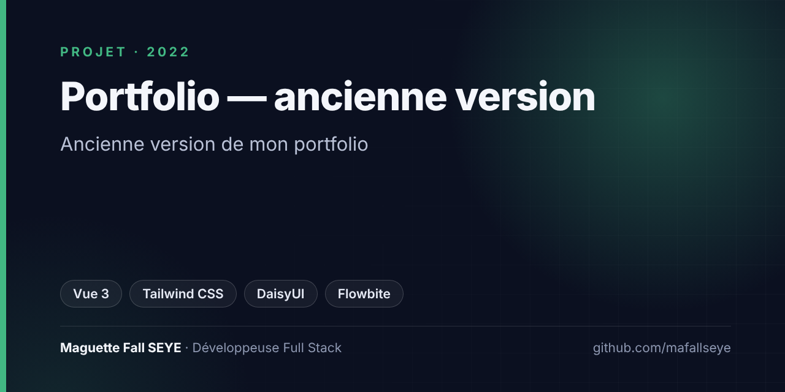

<p align="center"></p>

# Portfolio — ancienne version

Ancienne version de mon portfolio.

## Fonctionnalités

- Pages Accueil et À propos

## Technologies

Vue 3 · Tailwind CSS · DaisyUI · Flowbite

## Lancer le projet

Prérequis : Node.js 16 ou plus.

```bash
git clone https://github.com/mafallseye/maguettefseye.github.io.git
cd maguettefseye.github.io
npm install
npm run serve
```

> Projet réalisé en 2022 pendant ma formation. Il est conservé ici comme trace de mon parcours.

## Auteure

**Maguette Fall SEYE** — Développeuse Full Stack, Dakar (Sénégal) · [github.com/mafallseye](https://github.com/mafallseye)
